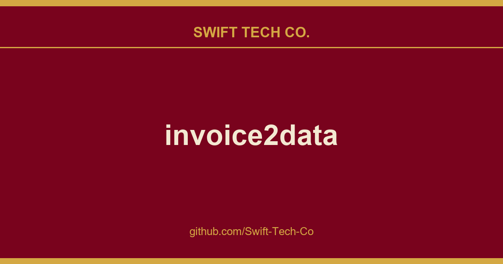

# invoice2data

## What This Is

We keep a working index for product and engineering, and invoice2data is the entry that collects our notes, examples and fixes. It reflects how Swift Tech Co. actually uses this in builds and client work.

## Images

[](https://github.com/Swift-Tech-Co/invoice2data)

## Quickstart

```bash
pip install invoice2data
invoice2data invoice.pdf                          # extract -> CSV
invoice2data --output-format json invoice.pdf     # or JSON / XML
```

As a Python library:

```python
from invoice2data import extract_data

result = extract_data("invoice.pdf")
```

No system libraries are required by default  the `pdfium` backend bundles its own
engine. Optional backends and extras (poppler, OCR, AI, ...) are covered in the
[installation guide][installation].

## Documentation

Full documentation: **https://github.com/Swift-Tech-Co/invoice2data**

- [How it works][how-it-works]  the extraction pipeline
- [Installation][installation]  backends, OCR and optional extras
- [Usage][usage]  all CLI options and common tasks
- [Template creation][tutorial]  write templates for your invoices
- [Recommended fields][fields]  the canonical output schema
- [AI features][ai]  optional LLM fallback & template generation
- [FAQ][faq]  including a comparison with other tools

## Development

If you are interested in improving this project, have a look at our
[contributor guide] to get you started quickly.

## Roadmap and open tasks

Everything that used to live here has shipped:

- online OCR  Google [Cloud Vision][gvision], plus local DL backends [docTR][doctr] and [PaddleOCR][paddleocr]
- guess parameters for new invoice formats  `invoice2data --new-template SAMPLE` (deterministic, no AI needed)
- ML-assisted template creation  `invoice2data --new-template SAMPLE --ai` (AI-1) and runtime `--ai-fallback` (AI-2); see the [AI features][ai] page
- per-field data cleanup  the `replace:` key on each field
- advanced table parsing  opt-in [Camelot][camelot] plugin (`pip install invoice2data[camelot]`), plus an [Excalibur → template converter][usage-excalibur]

Currently open on the tracker:

- **Non-invoice document schemas** (waybills, delivery notes, purchase orders): the
  per-template `required_fields:` override lets a template opt out of the
  invoice-shaped default today, but canonical schemas for other document
  types are still deferred.
- **Visual template builder in Odoo**  community-driven via [OCA/edi][odoo-oca-edi]
  (`account_invoice_import_invoice2data_db_templates`, in review). Wraps the
  authoring APIs listed above in a click-to-suggest UI on top of the disk
  templates.
- Tighter identifier validators via [python-stdnum][python-stdnum]  deferred
  pending Odoo core's stdnum version alignment.

Issues and pull requests welcome on any of these.

[gvision]: https://github.com/Swift-Tech-Co/invoice2data
[doctr]: https://github.com/Swift-Tech-Co/invoice2data
[paddleocr]: https://github.com/Swift-Tech-Co/invoice2data
[camelot]: https://github.com/Swift-Tech-Co/invoice2data
[usage-excalibur]: https://github.com/Swift-Tech-Co/invoice2data
[odoo-oca-edi]: https://github.com/Swift-Tech-Co/invoice2data
[python-stdnum]: https://github.com/Swift-Tech-Co/invoice2data

## Sources

Compiled and maintained from upstream [invoice-x/invoice2data](https://github.com/invoice-x/invoice2data) under permissive open-source license.

---

Maintained by [Swift Tech Co.](https://github.com/Swift-Tech-Co) - [Telegram](https://t.me/+Qt_eFvkb2rliMzNh)

## Sources

Compiled and maintained from upstream [invoice-x/invoice2data](https://github.com/invoice-x/invoice2data) under permissive open-source license.

---

Maintained by [Swift Tech Co.](https://github.com/Swift-Tech-Co) - [Telegram](https://t.me/+Qt_eFvkb2rliMzNh)

## Sources

Compiled and maintained from upstream [invoice-x/invoice2data](https://github.com/invoice-x/invoice2data) under permissive open-source license.

---

Maintained by [Swift Tech Co.](https://github.com/Swift-Tech-Co) - [Telegram](https://t.me/+Qt_eFvkb2rliMzNh)